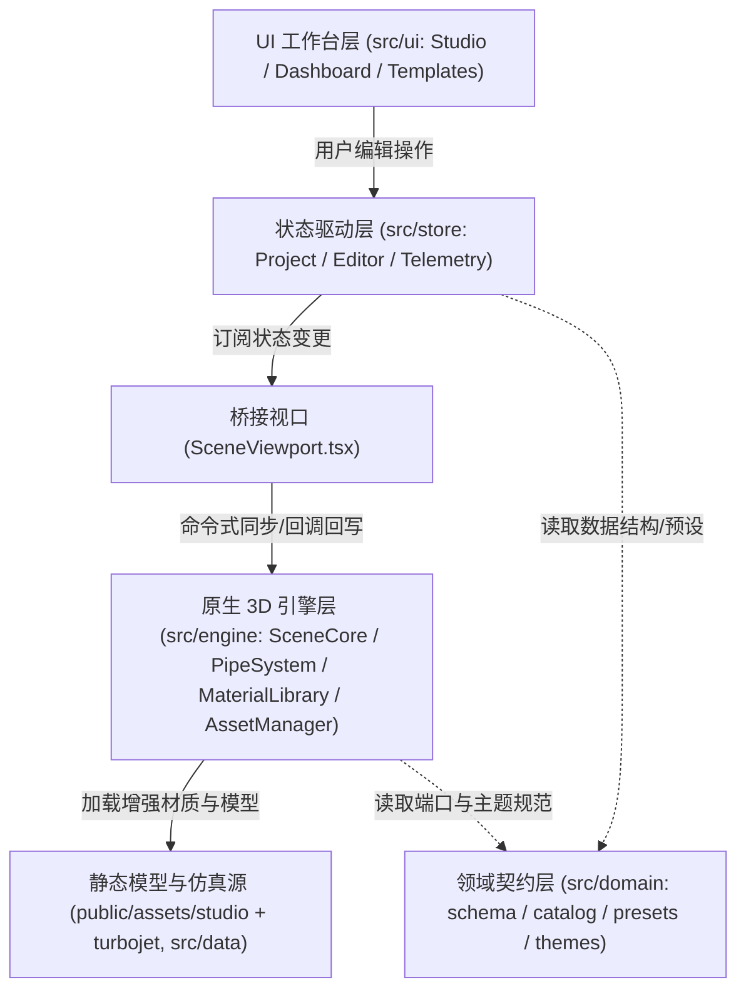

# Plant Station 3D Studio — 纯前端重工业 SCADA 3D 工艺低代码搭建平台

面向**燃气表智能制造、燃气输配调压、报警监控、水务换热与综合能源站**的纯前端 3D 工艺流程搭建与数字孪生大屏展示平台（监视-only）。

平台采用 **重工业 SCADA 视觉体系**（304 拉丝不锈钢、工业钴蓝、枪灰铸铁与混凝土基座），支持零外部建模软件依赖的资产离线批量生成、自由拖拉拽工艺组装、管网正交自动连线、可配置地坪与管道流场联动，并可直接切换为大屏编排与全屏汇报演示模式。

---

## 一、核心功能体系

### 1. 四态一体化工作流
- **模板中心 (`templates`)**：内置 4 套工艺示范工程——「燃气表智能制造与标定车间」「燃气输配调压与报警监控站」「重工业换热输送与综合能源站」「空白 3D 工艺画布」，支持 IndexedDB 本地工程库持久化管理以及 `.json` 工程文件导入/导出。
- **3D 搭建 (`studio`)**：左资产库/大纲、中 3D 交互画布、右上下文属性检查器三栏协同。
  - **鼠标直接拖拽 + 智能轴向磁吸**：默认选择工具下按住设备即可在地面水平拖动，靠近其他设备轴线自动呈现辅助对齐引导线并吸附。
  - **画布锁定模式**：一键锁定画布，禁用设备移动/连管/删除操作，仅保留缩放与旋转整体视角预览。
  - **资产实时 3D 缩略图**：左侧 37 项资产均由离屏 WebGL 自动渲染缩略图，鼠标悬停卡片即可触发 3D 模型实时自转预览。
  - **专业变换与整站导出**：支持 `TransformControls`（`Q/W/E/R`）、`±90°` 快捷旋转、50 步 `Ctrl+Z / Ctrl+Y` 撤销重做、`Ctrl+D` 复制、`F` 键聚焦、本地 `.glb` 导入以及一键将搭建好的厂站及管网导出为标准二进制 `.glb`。
- **大屏编排 (`dashboard`)**：基于 12 列自由栅格（`react-grid-layout`）拖拽/缩放业务监控卡片（核心运行指标、压力流量双波形趋势、安全报警监控、生产合格率、工段统计、选中设备详情）；网格空白区域可鼠标穿透直达底层 3D 画布，支持 3 套预设大屏模板及「视角书签」录制巡检。
- **全屏演示 (`present`)**：隐去全部编辑边框与辅助控件，提供纯净沉浸式 3D 数字孪生运行演示，按 `Esc` 一键返回。

### 2. 重工业 SCADA 3D 资产与可配置扩展组件
- **37 项工业资产目录**：覆盖 7 大工艺分类，其中 35 类工业设备/阀组/产线工位由脚本离线预编译为轻量 `.glb`（包含 `TK` 储罐、带冲孔网联轴护罩的离心泵、`HX-301` 板式换热器、双路调压撬、`SIGHT_GLASS` 管道流动视镜等），另有动态纹理驱动的立式双面 **`3D 工艺标牌 (TEXT)`** 与支持运转/爆炸/剖切/部件拾取的 **`涡喷透平总成 (TURBOJET)`**。
- **可配置厂房地坪组件（始终保留工程网格地面）**：
  - 支持项目级全局地坪配置：5 种质感切换（做旧工业混凝土地坪 / 深蓝灰环氧防静电地坪 / 冷峻深板岩地坪 / 防滑花纹工业钢板 / 纯净仅网格地面）、矩形/圆形边界、尺寸宽深调节、反光粗糙度与金属收口嵌边，且**网格地面独立铺设于上层，互不遮挡、随时可独立开关**。
  - 支持拖拽或一键放置独立分区地坪块 **`FLOOR_SLAB`**，单独调整长/宽比例及局部表面材质。
- **可配置管道流动组件 (`PipeFlowConfig`)**：
  - 选中任意自动连线管段或独立管件（`PIPE`、`PIPE_ELBOW`、`SIGHT_GLASS`）可实时切换 3 种流动模式：**外挂箭头光带 (`uv-chevron`)**、**透明硼硅视镜内流 (`glass-stream`)**、**3D 立体箭标 (`3d-arrow`)** 及静态关闭态。
  - 支持正向/反向一键反转、依据管道真实曲线弧长自适应定速、流向颜色/介质切换、DN50~DN250 口径调整及 **SCADA 测点联动驱动**（流量 `> 0` 按比例变速，为 `0` 或故障态自动停流）。

---

## 二、技术架构与目录结构

### 1. 技术选型清单

| 层级 | 技术栈 | 版本约束 | 作用说明 |
| :--- | :--- | :--- | :--- |
| **前端框架** | React + TypeScript | `18.3.x` / `~5.6.2` | 严格模式（`strict`、`noUnusedLocals`、`noUnusedParameters`）组件化工作台 |
| **构建工具** | Vite | `5.4.x` | ESM 构建与热更新，独立拆分 `react` 与 `three` 产物 chunk |
| **3D 渲染引擎** | Three.js（原生封装） | `0.170.x` | 命令式面向对象内核，隔离 React 调和开销，自带 `CSS2DRenderer` 与 `PMREMGenerator` |
| **状态与存储** | Zustand + idb-keyval | `5.1.x` / `6.3.x` | 三库职责分离，Schema v2 与项目库自动落盘 IndexedDB |
| **UI 与编排** | Tailwind CSS + react-grid-layout + Lucide | `3.4.x` / `2.3.x` / `1.79.x` | CSS Variable 换肤 Token + 12 列大屏自由网格编排 |
| **离线资产管线** | Node.js + `THREE.GLTFExporter` | - | 无 Blender 环境纯代码生成高精工业 `.glb` 与 `manifest.json` |

### 2. 系统分层与数据流向



### 3. 核心源码目录结构

```text
plant-station-3d-studio/
├── scripts/
│   └── generate-studio-assets.mjs    # 离线重工业 3D 模型生成器（产出 35 个 .glb 与清单）
├── public/assets/
│   ├── studio/                       # Studio 主力重工业资产库（35 个 .glb + manifest.json，Git LFS 跟踪）
│   └── turbojet/                     # 精密涡喷透平演示总成（turbojet.glb + part-mapping）
└── src/
    ├── domain/                       # 领域建模层（纯 TS 数据契约）
    │   ├── schema.ts                 #   ProjectSchema v2 / SceneNode / PipeEdge / GroundConfig / PipeFlowConfig
    │   ├── catalog.ts                #   37 项资产目录定义、分类、Tag 前缀与默认高度
    │   ├── presets.ts                #   4 套开箱即用的工艺场景预设
    │   └── themes.ts                 #   内置主题与 CSS Token / 3D 氛围映射
    ├── store/                        # Zustand 状态库
    │   ├── useProjectStore.ts        #   节点/管线/地坪/大屏 CRUD、50 步历史栈与 IndexedDB 持久化
    │   ├── useEditorStore.ts         #   模式切换、工具选择、画布锁定、选中态与相机控制指令
    │   └── useTelemetryStore.ts      #   22 路标准测点实时模拟步进、趋势历史与报警队列
    ├── engine/                       # 纯原生 Three.js 渲染与建模内核（脱离 React）
    │   ├── SceneCore.ts              #   渲染器、工业灯带 HDR 环境、射线直拖/磁吸、60fps Tick 主循环
    │   ├── AssetManager.ts           #   多源模型调度（Studio GLB / TURBOJET / TEXT 立牌 / 本地导入）
    │   ├── MaterialLibrary.ts        #   程序化 Canvas PBR 贴图（拉丝、冲孔网、叠片、地坪与管道流向纹理）
    │   ├── PipeSystem.ts             #   正交倒角布管、地面管道支架、三种可配置流动引擎与测点驱动
    │   ├── ThumbnailGenerator.ts     #   离屏缩略图中心（复用主场景同等工业灯带环境渲染）
    │   ├── SceneExporter.ts          #   整站二进制 .glb 导出器
    │   └── turbojet/                 #   涡喷透平 Rig（运转/爆炸/剖切控制器）
    ├── data/                         # 标准工业测点字典、M1 拓扑定义、快照源与校验脚本
    └── ui/                           # React 视图界面（components / studio / dashboard / templates）
```

---

## 三、架构核心优势

1. **命令式 Three.js 内核与 React 状态解耦（高帧率、低耦合）**
   - 所有 3D 高频操作（鼠标地面直拖、轴向磁吸对齐、`OrbitControls` / `TransformControls`、`CSS2D` 标签坐标追踪、管道流动帧动画）均封闭在 [SceneCore.ts](file:///e:/antigravity-projects/%E4%B8%AA%E4%BA%BA%E9%A1%B9%E7%9B%AE/plant-station-3d-studio/src/engine/SceneCore.ts) 内部独立运行，拖拽结束再向 `useProjectStore` 提交一次增量更新并压入撤销栈，彻底避免高频状态触发 React 重渲染导致卡顿。
   - 通过 `sig` 签名比对机制实现模型异步下载后的**无感热替换**与局部属性最小化重建。
2. **轻量化几何与运行时材质注入体系（无需安装 Blender 即可协同迭代）**
   - 离线脚本生成的 `.glb` 不内嵌大尺寸纹理图片，单模型体积多控制在 `10 KB ~ 640 KB`；所有金属拉丝、冲孔护网、板换波纹叠片、做旧混凝土及工业天棚灯带反射均由 [MaterialLibrary.ts](file:///e:/antigravity-projects/%E4%B8%AA%E4%BA%BA%E9%A1%B9%E7%9B%AE/plant-station-3d-studio/src/engine/MaterialLibrary.ts) 在浏览器端一次性生成确定性 `CanvasTexture` 并复用缓存，兼顾极快首屏加载与统一视觉质感。
3. **全配置化 Schema v2 序列化体系**
   - 画布所有设备坐标、旋转缩放、涂装、地坪规格、管路流向参数、测点绑定关系以及大屏 12 列卡片布局均描述在纯 JSON 友好的 `ProjectSchema` 中，天然具备**零代码导出分享、跨端复现与云端存储无缝迁移**能力。

---

## 四、后续对接与扩展兼容指南

### 1. 对接真实后端 SCADA / IoT 实时数据（WebSocket / MQTT / HTTP）
当前遥测数据由 [useTelemetryStore.ts](file:///e:/antigravity-projects/%E4%B8%AA%E4%BA%BA%E9%A1%B9%E7%9B%AE/plant-station-3d-studio/src/store/useTelemetryStore.ts) 定时步进模拟。对接真实产线时仅需：
- 在该 Store 中关闭模拟定时器，接入 WebSocket / MQTT 消息监听；
- 按现有 `PointValue` 结构（`{ id, value, quality: 'GOOD' | 'UNCERTAIN' | 'BAD' | 'NODATA', ts }`）更新 `valueMap` 与 `alarms`；
- 3D 管道流动引擎与大屏卡片（`widgets.tsx`）会直接读取更新后的 `valueMap` 自动响应流向启停、变速及质量态告警。

### 2. 兼容 Blender / CAD 导出的高精度 `.glb` 模型
平台完全兼容标准 glTF 2.0 二进制模型（`.glb`），既可在界面左下角**直接导入本地 `.glb`**，也可替换 `public/assets/studio/` 下的默认模型。为保证外部模型直接享受平台光影、调色与自动连管能力，建议遵循以下约定：
- **坐标系与比例**：`1 unit = 1m`，`+Y` 朝上；设备主体底部贴齐 `Y = 0` 原点平面。
- **材质命名契约**（在 Blender 材质名称设为以下槽位即可自动接入运行时 PBR 纹理与自定义着色）：
  - `mat:stainless`：自动注入 304 拉丝不锈钢凹凸/粗糙度与强金属高光反射；
  - `mat:industrialBlue` / `mat:paint*`：支持在右侧属性面板实时「涂装色彩」改色；
  - `mat:castIron` / `mat:steelSlate`：自动注入砂铸金属质感；
  - `mat:concretePlinth`：自动注入混凝土水泥台微粗糙斑驳纹理；
  - `mat:perforatedMetal`：自动应用不锈钢冲孔网格镂空贴图。
- **自动连管端口锚点**：在 Blender 中添加空物体（Empty）命名为 `Port_in`、`Port_out`（多口换热器等可增加 `Port_cold_in` / `Port_cold_out`），并在自定义属性写入 `portId` 与 `normal: [nx, ny, nz]`；若外部模型未设置 `Port_*`，[AssetManager.ts](file:///e:/antigravity-projects/%E4%B8%AA%E4%BA%BA%E9%A1%B9%E7%9B%AE/plant-station-3d-studio/src/engine/AssetManager.ts) 中的 `extractObjectPorts` 也会自动按模型包围盒左右边缘推导兜底端口。

### 3. 工程持久化对接云端接口
目前 [useProjectStore.ts](file:///e:/antigravity-projects/%E4%B8%AA%E4%BA%BA%E9%A1%B9%E7%9B%AE/plant-station-3d-studio/src/store/useProjectStore.ts) 通过 `idb-keyval` 将当前工程与本地工程库保存在浏览器 IndexedDB 中。如需接入服务端多租户项目管理：
- 仅需将 `hydrateFromStorage`、`saveCurrentToLibrary`、`loadFromLibrary`、`deleteFromLibrary` 与 `refreshLibrary` 五个异步方法对接为后端 REST API，请求体直接传输完整 `ProjectSchema` JSON 即可，无需修改 3D 引擎或 UI 代码。

### 4. 新增设备资产或大屏卡片扩展路径
- **新增 3D 设备**：`src/domain/catalog.ts` 注册类型与条目 -> `scripts/generate-studio-assets.mjs` 编写模型或放入外部 `.glb` 到 `public/assets/studio/` -> 运行 `node scripts/generate-studio-assets.mjs` 更新 `manifest.json`。
- **新增大屏业务卡片**：`src/domain/schema.ts` 扩展 `DashboardWidgetType` -> `src/ui/dashboard/widgets.tsx` 添加卡片渲染组件即可立即参与 12 列自由拖放编排。

---

## 五、本地开发与构建指令

> 注意：仓库中的 `.glb` 大体积模型资产由 **Git LFS** 管理，克隆代码前请确保已安装并启用 `git lfs install`。

```bash
# 1. 安装依赖
npm install

# 2. 启动 Vite 本地开发服务器
npm run dev

# 3. 离线重新生成重工业 Studio GLB 资产库（输出至 public/assets/studio/，共 35 个模型）
node scripts/generate-studio-assets.mjs

# 4. 校验测点定义、质量态与工艺拓扑断言
npm run assert:m1

# 5. TypeScript 严格类型校验与 Vite 生产打包
npm run build

# 6. 本地预览生产构建产物
npm run preview
```
