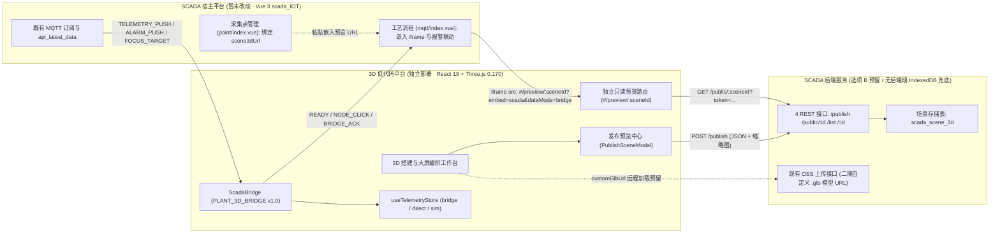

# Plant Station 3D Studio ↔ SCADA 集成架构方案与决策归档（ADR）

> **文档目的**：系统记录 `plant-station-3d-studio`（3D 工艺低代码搭建平台）嵌入集成到 `scada`（厂站生产监控系统，`scada_IOT` 分支）的技术背景、架构决策（包含**已采纳方案**与**未采纳备选方案**及其取舍理由）、当前 3D 前端已落地能力清单，以及后续后端与 SCADA 侧接入路线图，便于后续研发回溯与跨团队对接。
>
> **关联协议文档**：REST 接口入出参明细与 `PLANT_3D_BRIDGE` `postMessage` 协议见 [SCADA_INTEGRATION_CONTRACT.md](./SCADA_INTEGRATION_CONTRACT.md)。

---

## 一、项目背景与双端源码现状诊断

### 1.1 业务目标
- 3D 平台（`plant-station-3d-studio`）作为**独立项目**单独部署维护；
- 在 3D 平台上为各个厂站（SCADA 中的「采集点」）搭建 3D 模型场景与可配置大屏卡片后，发布生成一个稳定的**预览链接**；
- 在 SCADA 平台的 **「采集点管理」** 中关联保存该链接，并在 **「工艺流程」** 页面中嵌入展示对应厂站的 3D 工艺大屏，并与实时数据、设备报警双向联动。

### 1.2 双端技术栈与架构差异

| 对比维度 | SCADA 平台（`E:\code\scada`，`scada_IOT` 分支） | 3D 低代码平台（`E:\plant-station-3d-studio`） | 架构约束与启示 |
| :--- | :--- | :--- | :--- |
| 前端框架与 UI | `Vue 3.5` + `Element Plus 2.11` + `Pinia` + `UnoCSS`（`package.json` `v2.15.0`） | `React 18.3` + `Zustand 5` + `Tailwind CSS` + `react-grid-layout` | 异构技术栈，必须运行期隔离，禁止源码级混编 |
| 三维与图表库 | `three@0.142.0`、`echarts@5.5.1` | `three@0.170.0`、`echarts@6.1.0` | `three` 主版本跨度大，同上下文打包或共存极易触发原型/Shader 冲突 |
| 路由与鉴权 | Hash 路由 + 动态权限菜单（`permission.ts`），`localStorage.accessToken` 注入 `Authorization`（`request-scad.ts`） | 独立单页多模式工作台 + `#/preview/:sceneId` 独立预览路由 | 3D 预览页不接管主站登录态，通过 `shareToken` + Origin 白名单保障安全性 |
| 工艺流程现状 | `src/views/dispatch-task/mqtt/index.vue` 已采用 `<iframe class="jetlinks-preview-frame">` 嵌组态，下方含报警表、告警音与 `mqtt` 订阅 | 原为纯前端 IndexedDB 草稿运行态，本次改造后已支持发布态、嵌入运行壳与 `ScadaBridge` | SCADA 工艺流程天然适配 `iframe` 嵌入，且可零成本复用既有 MQTT 连接 |
| 业务主键层级 | 「采集点管理」`dispatch-task/point/index.vue` 为测点级（对应 `bus/realtime/data/{id}`）；「节点管理」`dispatch-task/node/index.vue` 为最多 5 级树节点 | `SceneNode` 可绑定多个 `pointIds` 与 `customPoints` | 当前按「采集点 = 厂站入口」绑定预览链接，同时在 3D 内部通过 `PointId` 映射厂站内多台设备的实时测点 |

---

## 二、架构选型决策记录（ADR：含已采纳与未采纳方案）

### ADR-1：跨系统嵌入集成方式

#### ✅ 已采纳方案：独立部署 + 短预览链接 + `iframe` 沙箱隔离 + `postMessage` Bridge
- **核心做法**：3D 平台独立打包、独立部署；配置发布后产出 `#/preview/{sceneId}?token=...&embed=scada&dataMode=bridge`；SCADA 通过 `iframe` 嵌入该预览 URL，并基于标准化的 `PLANT_3D_BRIDGE` `postMessage` 协议做遥测推流、报警通知与点击联动。
- **核心优势**：
  1. **框架与样式 100% 隔离**：Vue 3 / UnoCSS 与 React 18 / Tailwind / Three.js 0.170 彻底解耦，互不污染，双方各自独立升级发版；
  2. **WebGL 显存彻底回收**：切换厂站时销毁并重建 `iframe`（变更 `:key`），浏览器强制释放 WebGL Context 与 GPU 纹理显存，杜绝多站点切换引发的内存泄漏或黑屏崩溃；
  3. **一次发布、多处复用**：同一套预览链接既可嵌进 SCADA，也可用于指挥中心独立投屏或嵌入 GIS 等其他业务门户；
  4. **贴合 SCADA 现状**：与 `mqtt/index.vue` 现行 `iframe` 组态嵌入习惯一致，改造成本最低。

#### ❌ 未采纳备选方案（留档对比）

| 未采纳方案 | 技术实现思路 | 适用场景 | 未采纳 / 淘汰原因 |
| :--- | :--- | :--- | :--- |
| **备选 1：将 3D 低代码编辑器直接打包/同域挂载进 SCADA（编辑器内嵌模式）** | 把 3D 工程 JSON 存为 SCADA 内部字段，在 SCADA 弹窗里直接打开 3D 搭建与大屏编排工作台编辑保存 | 只给单个系统内部专用的重度耦合平台 | ① 不符合「3D 平台独立存在、产链接供嵌入」的定位；② 会强制把编辑态、预览态耦合进 SCADA 权限和布局，后续难以跨系统复用 |
| **备选 2：微前端架构（`micro-app` / `wujie` / `qiankun`）** | 将 React 3D 应用作为微应用挂载到 Vue 宿主 DOM 容器中 | 需要共用大量登录状态、弹窗交互、同一路由栈的后台表单类子应用 | ① Three.js `Raycaster` 射线拾取、`CSS2DRenderer` 坐标、`react-grid-layout` 拖拽在微前端事件劫持或 ShadowDOM 下极易发生偏移与事件吞吐；② 子应用卸载时 WebGL 显存和 Three 全局缓存极难干净回收 |
| **备选 3：打包为 WebComponent / UMD SDK 引入 SCADA** | 在 3D 平台新增构建入口编成独立 JS 组件包，由 SCADA `npm install` 后在 Vue 组件内渲染 | 轻量纯渲染且技术栈可控的 SDK | ① 3D + ECharts + 材质核心全量打包超 1.5MB，严重拖慢 SCADA 打包与首屏；② Tailwind 与 Element Plus / UnoCSS 样式易互扰；③ 与 SCADA 内置 `three@0.142.0` 存在版本管理隐患；④ 3D 每次迭代都迫使 SCADA 重新构建发版 |

---

### ADR-2：发布配置存储与预览链接生成机制

#### ✅ 已采纳方案（选项 B）：独立后端场景库 + 4 个 REST 接口 + 短场景链接（前端先行内置本地适配预留）
- **核心做法**：3D 平台点击「发布」时，将 `ProjectSchema`（含 3D 拓扑、管流参数、24 列大屏卡片、自定义模板与绑定点位）与缩略图存入独立后端表 `scada_scene_3d`，返回永久短 ID `sceneId` 与自增版本号 `revision`，生成链接 `#/preview/{sceneId}?token=...`。
- **关键收益**：
  - **重发布链接零变更**：后续在 3D 平台调整设备位置、增改大屏卡片后重新发布，只递增 `revision`，**SCADA 采集点表里填写的 URL 完全不用修改**；
  - **支持草稿与线上隔离、Token 防盗链与版本追踪**；
  - **后端未开工前零阻塞**：3D 前端通过 `ScenePublishAdapter` 抽象双实现，默认启用 `localMockPublishAdapter`（IndexedDB）跑通全流程闭环，待后端上线后切换为 `remoteApiPublishAdapter`（或环境变量 `VITE_SCENE_API_BASE`）即可。

#### ❌ 未采纳备选方案（留档对比）

| 未采纳方案 | 技术实现思路 | 适用场景 | 未采纳 / 淘汰原因 |
| :--- | :--- | :--- | :--- |
| **备选 1（选项 A）：发布静态 JSON 到现有 OSS（`?config=OSS_JSON_URL`）** | 不建后端表与接口，点击发布时直接把工程 JSON 传到公司现有 OSS（`VITE_APP_BASE_API_UPLOAD`），链接把 OSS 地址挂在 Query 参数后 | 完全无法排期任何新后端接口、仅内部临时演示 | ① 缺乏版本号管理、草稿/发布隔离及 Token 鉴权；② 若走时间戳文件名覆盖则需改 SCADA 链接，若走同路径覆盖容易受 CDN/浏览器缓存影响生效延迟；③ 后续自定义 `.glb` 大文件仍会使用 OSS `customGlbUrl`，而主配置走选项 B 后端表最稳妥 |
| **备选 2：纯前端 URL Hash 压缩（Base64/Gzip JSON）或手写静态 JSON 放入 `public/`** | 把完整工程 JSON 压缩进 URL，或手动导出 JSON 丢进静态目录发布 | 极小的静态演示工程、无动态编辑需求 | `ProjectSchema` 随卡片模板和设备增多动辄几十 KB 甚至上百 KB，远超浏览器/Nginx URL 长度限制（通常 4KB~8KB），且每次修改都得重新打包静态文件，完全不可持续 |

---

### ADR-3：实时数据与报警驱动机制

#### ✅ 已采纳方案：双模自适应（嵌入 SCADA 默认走宿主 `postMessage` 桥接，独立投屏走 `DataSourceManager` 直连/仿真）
- **核心做法**：
  - **嵌入模式（`?embed=scada&dataMode=bridge`）**：3D 预览页启动时调用 `prepareForBridgeMode()` **关闭内置 1.5s 仿真步进和独立轮询**，不重复建立 MQTT/WebSocket 连接，也不在 URL 中暴露用户 Token 或 MQTT 账密；由宿主 SCADA 页面复用现有 `api_latest_data` 与 MQTT 报文（`bus/realtime/data/{pointId}`），经节流合并后通过 `TELEMETRY_PUSH` / `ALARM_PUSH` 推入 `iframe`。
  - **独立投屏模式（无 `embed=scada`）**：走 `dataMode=direct`（启用项目配置的 `http-rest` / `websocket` / `static-json` 直连）或 `sim`（内置工艺仿真，适合大屏展厅演示）。
- **核心优势**：服务端 MQTT 并发连接数零翻倍、无跨域/鉴权 Token 泄漏风险，并天然支持「点击报警飞往 3D 设备（`FOCUS_TARGET`）」和「点击 3D 设备联动 SCADA 筛选告警（`NODE_CLICK`）」的双向交互。

#### ❌ 未采纳备选方案（留档对比）

| 未采纳方案 | 技术实现思路 | 适用场景 | 未采纳 / 淘汰原因 |
| :--- | :--- | :--- | :--- |
| **备选 1：嵌入 SCADA 时仍由 3D `iframe` 自行直连 MQTT-over-WS 与 HTTP 接口** | 在预览 URL 传入 SCADA 登录 Token，由 `iframe` 内部自己连接 `wss://.../mqtt/` 并轮询历史/最新接口 | 完全脱离宿主的单页大屏（已作为本方案独立投屏模式的 `direct` 保留） | ① 同屏打开页面时浏览器的 WebSocket 连接数与 MQTT 订阅翻倍，切换站点易造成 MQTT 断连重连风暴；② URL 传参或跨域传递主站 Token 存在安全泄露面；③ 无法直接联动 SCADA 下方既有报警列表定位事件 |
| **备选 2：3D 只负责渲染模型，数据完全由 SCADA 在父容器里叠加透明 DOM** | 禁用 3D 平台的低代码卡片引擎，只渲染纯 3D 画布，数据卡片改在 Vue 里叠加 | 只需简单 3D 展示、不需要 2D+3D 联合配置模板的场景 | 浪费了 3D 平台已经建好的「24 列组态卡片 + 原子元素 + ECharts 图表 + 模板绑定设备模型」能力，且会造成「配置体验割裂」 |

---

### ADR-4：SCADA「采集点管理」与 3D 厂站内部多设备的映射关系
- **现状约束**：SCADA `dispatch-task/point/index.vue` 中每条记录是单个测点（`id`, `name`, `code`, `deviceCode`），而用户规划为「每个采集点代表一个厂站，厂站 3D 大屏内部有多台设备和多个测点」。
- **处理原则**：
  1. 在 3D 平台发布时预留 `stationCode` 绑定 SCADA 采集点 ID/编码；
  2. 3D 内部各设备（`SceneNode.pointIds` / `customPoints`）及大屏卡片元素（`binding.pointKey`）直接使用 SCADA 真实点号或统一测点 Key；
  3. 桥接通信同时支持标准 `{ id, value, quality }` 数组与 SCADA 原生 MQTT 原始格式 `{ PointId, RealtimeData: { Value }, IsAlarm }`，后续 SCADA 侧只需把对应厂站关联测点的消息（或整个订阅消息池）透传进 `iframe`，3D 内部会自动按点号精确分发给每台设备、管段流速和图表。

---

## 三、最终总体集成架构与数据流

---

## 四、3D 平台前端已落地清单（当前阶段已完成）

3D 平台前端已全面开发并完成构建与实机全链路验收（`scada` 仓库保持零修改）：

1. **发布存储适配层（选项 B 预留）**：
   - `src/domain/schema.ts`：新增 `publishedSceneId`、`stationCode`、`customGlbUrl`、`DataFeedMode`、`PublishStorageMode`、`PublishEndpointSettings`、`PublishedSceneRecord`。
   - `src/api/scenePublishClient.ts` & `src/store/usePublishStore.ts`：实现本地预留仓库 `localMockPublishAdapter`（IndexedDB，支持同 `sceneId` 覆盖更新、`revision` 自增、Token 校验）与远程后端客户端 `remoteApiPublishAdapter`（兼容裸 JSON 与 SCADA `{ succeeded, data, errors }` 响应格式）。
2. **预览 URL 路由与独立运行壳**：
   - `src/domain/runtimeUrl.ts`：解析 `#/preview/{sceneId}` 与 `?mode=preview&sceneId=...`，识别 `token`、`embed=scada`、`dataMode`、`parentOrigin`、`chrome=0`。
   - `src/ui/components/PreviewRuntimeShell.tsx`、`src/App.tsx`、`src/store/useProjectStore.ts`：预览入口只读挂载 `loadRuntimeProject(schema)`，不覆盖工作台草稿，完整隐藏编排工具栏并提供 `SCENE_NOT_FOUND` / `INVALID_TOKEN` 异常拦截界面。
   - `src/ui/dashboard/DashboardOverlay.tsx`：预览运行态隐藏「退出演示」和干扰按钮，并在桥接模式展示「SCADA 桥接实时 · N 帧」状态指示。
3. **SCADA 双向通信与双模遥测引擎**：
   - `src/engine/ScadaBridge.ts`：完整落地 `PLANT_3D_BRIDGE` v1.0 协议，处理 `TELEMETRY_PUSH`（兼容标准点表与 SCADA 原生 MQTT 报文）、`ALARM_PUSH`、`FOCUS_TARGET`、`POINT_CATALOG_SYNC`、`LOAD_SCHEMA`、`SET_THEME`，并上报 `READY`、`NODE_CLICK`、`BRIDGE_ACK`。
   - `src/store/useTelemetryStore.ts`：新增 `dataFeedMode`、`bridgeStatus`、`bridgeCatalog`、`prepareForBridgeMode()`；切入 `bridge` 模式自动停用本地 1.5s 仿真步进。
   - `src/engine/SceneCore.ts`、`src/engine/AssetManager.ts`、`src/ui/components/SceneViewport.tsx`：新增 3D 视口 JPEG 抓图（`captureThumbnailDataUrl`）、点击设备上报 `NODE_CLICK`、以及 `customGlbUrl` 远程 `.glb` 异步加载支持；在 `InspectorPanel.tsx` 与 `DashboardInspector.tsx` 点位下拉自动合并 `bridgeCatalog`。
4. **发布预览中心与 SCADA 联调沙盒**：
   - `src/ui/components/TopNav.tsx` 新增高可见度「发布预览」主入口。
   - `src/ui/components/PublishSceneModal.tsx` 提供「发布与生成链接」「已发布场景 & 后端配置」「SCADA 桥接联调沙盒 & 协议」三页签，内置真实 `iframe` 沙盒、MQTT 推流模拟器、超限告警模拟、设备定位模拟及双向报文监视器。
   - `docs/SCADA_INTEGRATION_CONTRACT.md` 已沉淀后端 SQL 与联调报文契约。

---

## 五、后续待实施路线图（后端 & SCADA 侧）

| 阶段 | 执行方 | 待办核心任务 | 对接切入点 |
| :--- | :--- | :--- | :--- |
| **Step 1：后端持久化上线** | 后端研发 | 按契约创建 `scada_scene_3d` 表并开放 `/publish`、`/public/{sceneId}`、`/list`、`/{sceneId}` 4 个接口（若支持自定义模型同步传 OSS，复用上传接口返回 `customGlbUrl`） | 3D 平台「发布预览 → 已发布场景 & 后端配置」切到「远程后端接口」或配置 `VITE_SCENE_API_BASE` 即可生效 |
| **Step 2：SCADA 采集点管理改造** | SCADA 前端 + 后端 2 字段 | 采集点表与接口补充 `scene3dUrl`（与可选 `scene3dName`）；`point/edit.vue` 支持粘贴与测试预览 3D 链接；`point/index.vue` 增加绑定状态列与「查看 3D」跳转 | `src/views/dispatch-task/point/index.vue`、`edit.vue` |
| **Step 3：SCADA 工艺流程嵌入与联动** | SCADA 前端 | `mqtt/index.vue` 顶部增加厂站切换、`3D 大屏 / 原组态` 视图开关；封装 `<Plant3DFrame>` 加载 `scene3dUrl`；收到 `READY` 后下发 `api_latest_data` 并把 `mqttClient` 报文节流 `postMessage` 至 `iframe`；打通报警行点击聚焦与 `NODE_CLICK` 报警过滤 | `src/views/dispatch-task/mqtt/index.vue` |
| **Step 4：Nginx 部署与安全加固** | 运维 / 前端 | 为 3D 平台独立域名配置 HTTPS 与 `Content-Security-Policy: frame-ancestors 'self' https://scada...`；SCADA 侧 `iframe` 声明 `allow="fullscreen; autoplay"` 与绑定 `:key="currentPointId"` 确保切换厂站彻底回收 WebGL 上下文；预览链接加上 `parentOrigin` 严格校验 | Nginx 站点配置、环境变量 `.env.production` |
